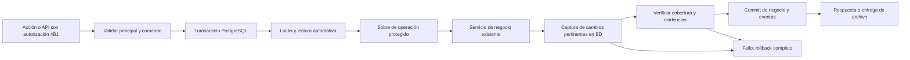

# Fase 4B3-A — evaluación GMP y diseño del Audit Trail

**Estado:** propuesta para revisión de QA/DT/IT, no especificación aprobada ni evidencia de validación. Corte: 2026-10-12. Base inspeccionada: `main`, `d3b55b3c980f07f092c79a78e8f031d2b508ad70`, integración de #140/4B2. Rama: `feature/phase4b3a-gmp-audit-trail-design`. Entrega exclusivamente documental; ninguna tabla, migración, permiso, dato, pantalla o infraestructura se modifica.

El historial existente ofrece una base reutilizable, con protecciones específicas en PNT y programas anuales, pero carece de cobertura y atomicidad uniformes para todas las operaciones relevantes. La propuesta prioriza cambios administrativos, valores anteriores completos, identidad explícita por cliente y custodia documental; combina servicio transaccional y captura PostgreSQL, con revisión separada. La matriz siguiente contiene 63 operaciones cuya inclusión y criticidad debe aprobar QA/DT antes de autorizar B.

## 1. Uso previsto, alcance y marco regulatorio

Hipótesis para evaluar con QA/DT: COVEX Quality Manager conserva registros y documentos del sistema de calidad que pueden fundamentar investigaciones, decisiones sobre producto, eficacia CAPA y vigencia documental. No se presume que certifique/libere lotes, controle equipos, sea LIMS ni produzca firmas electrónicas. QA/DT debe confirmar qué registros son maestros GMP, cuáles son auxiliares y qué documentos externos siguen siendo originales controlados. El impacto sobre el paciente puede ser indirecto, a través de decisiones de calidad incorrectas o evidencia incompleta.

Se propone cubrir las operaciones GMP pertinentes de los siete módulos, sus documentos/relaciones y la administración que pueda afectar su integridad. 4B1 conserva identidad/autorización; 4B2 conserva recuperación. El audit trail no reemplaza snapshots, registros de negocio, controles documentales, seguridad, change control ni procedimientos de revisión.

### 1.1 Fuentes oficiales y condición de aplicación

Referencias consultadas el 2026-10-12; resúmenes de aplicabilidad, no reproducción de los textos. Antes de implantar, QA/Regulatorio debe reconfirmar versiones, ámbito de autorización y procedimientos aplicables.

| ID | Fuente y versión | Condición / uso en este diseño |
| --- | --- | --- |
| N11 | [EU GMP Anexo 11, revisión enero 2011](https://health.ec.europa.eu/system/files/2016-11/annex11_01-2011_en_0.pdf) | Referencia vigente publicada para sistemas usados en actividades GMP. Alcance según uso previsto. |
| N4 | [Parte I, Capítulo 4, enero 2011](https://health.ec.europa.eu/document/download/104b3eb8-81a7-4858-9419-cb06562adb66_en?filename=chapter4_01-2011_en.pdf) | Documentación GMP; distinguir originales, copias, plantillas y sistemas híbridos. |
| N2 | [Parte II, agosto 2014](https://health.ec.europa.eu/document/download/bd537ccf-9271-4230-bca1-2d8cb655fd83_en?filename=2014-08_gmp_part1.pdf) | Condicional a fabricación de principios activos; especialmente 5.40–5.49 y 6.10–6.18. El nombre del PDF no cambia su contenido Parte II. |
| NP | [PIC/S PI 041-1, 1 julio 2021](https://picscheme.org/layout/document.php?id=714) | Guía de expectativas/prácticas, especialmente 5, 7, 9.5–9.10; no legislación autónoma. |
| NQ | [ICH Q9(R1), Step 4 de 18 enero 2023, corrección 26 enero](https://database.ich.org/sites/default/files/ICH_Q9%28R1%29_Guideline_Step4_2023_0126.pdf) | Método de gestión de riesgos; justificar incertidumbre, formalidad y revisión. Confirmar implantación regional aplicable. |
| ND | [Consulta CE de 2025](https://health.ec.europa.eu/consultations/stakeholders-consultation-eudralex-volume-4-good-manufacturing-practice-guidelines-chapter-4-annex_en) | Abierta 7 julio–7 octubre 2025; cerrada. Sus textos siguen identificados como borradores. |

El [índice oficial de EudraLex Volumen 4](https://health.ec.europa.eu/medicinal-products/eudralex/eudralex-volume-4_en) consultado sigue listando Anexo 11 y Capítulo 4 de enero de 2011. Los [borradores de Anexo 11](https://health.ec.europa.eu/document/download/40231f18-e564-4043-94de-c031f813d38b_en?filename=mp_vol4_chap4_annex11_consultation_guideline_en.pdf) y [Capítulo 4](https://health.ec.europa.eu/document/download/fa336a6e-753b-46fc-b53b-9178bacd8878_en?filename=mp_vol4_chap4_consultation_guideline_en.pdf) de 2025 sirven para seguimiento: **no son obligaciones vigentes ni aprobación del diseño**. No confundir el apartado 9 de audit trails del Anexo vigente con el apartado 12 del borrador. No adoptar automáticamente sus reglas de revisión, acceso o firma. Si el uso incluye productos veterinarios, QA/Regulatorio debe confirmar su marco específico vigente; no extrapolar sin evaluación el ámbito de medicamentos humanos.

### 1.2 Aplicabilidad a requisitos propuestos

| Referencia vigente | Aspecto a evaluar | Requisitos de diseño relacionados |
| --- | --- | --- |
| N11 §1 | Riesgo de calidad, paciente e integridad | U01, U10 |
| N11 §4, especialmente 4.4/4.8 | Requisitos trazables y transferencia verificada | U01, U08, U10 |
| N11 §7 | Protección, disponibilidad y recuperación comprobada | U06, U08 |
| N11 §9 | Cambios/borrados GMP, motivos, legibilidad y revisión | U02–U07 |
| N11 §10 | Cambios/configuración controlados | U09, U10 |
| N11 §11 | Evaluación periódica del sistema | U07, U10 |
| N11 §12.3/12.4 | Autorizaciones y atribución de actuaciones | U03, U09 |
| N11 §13 | Evaluación e investigación de incidentes | U07, U10 |
| N11 §17 | Archivo accesible e íntegro | U06, U08 |
| N4 4.1–4.5, 4.8–4.12 | Control, contemporaneidad, rectificación y conservación documental | U02, U05–U08 |
| N2 5.43/5.46–5.49, 6.10–6.18, si aplica | Cambios atribuibles y documentación recuperable | U02, U03, U08 |
| NP 7, 9.5–9.9 | Integridad, seguridad y revisión basada en riesgos | U03–U09 |
| NQ 3–5 | Evaluación, control y revisión del riesgo | U01, U10 |

ALCOA+ se utiliza como criterio de diseño: atribuible (principal estable), legible (valores tipados y diccionario versionado), contemporáneo (captura al guardar), original (valor observado y procedencia), exacto (diff desde BD), completo (todas las escrituras incluidas), consistente (orden/concurrencia), duradero (protección/retención) y disponible (consulta/recuperación). Es un conjunto de principios; no una certificación del producto ni una obligación autónoma adicional.

## 2. Evaluación del estado actual y evidencia

Inspección estática de código, esquema y migraciones del SHA base; no se consultaron registros reales ni se probaron privilegios de un servidor corporativo. La existencia de una guarda en el repositorio no acredita su despliegue/eficacia en producción. Las afirmaciones siguientes distinguen controles existentes de lagunas y propuestas.

### 2.1 Evidencias del código

Las rutas son relativas al repositorio y los números de línea corresponden al SHA base. Los enlaces permiten revisar el contenido; funciones y modelos son los localizadores principales.

| ID | Evidencia | Confirmado / límite |
| --- | --- | --- |
| E01 | [schema.prisma](../prisma/schema.prisma), `ChangeHistory` L1193 y `QmsRecordVersion` L1211; [versioning.ts](../src/lib/qms/versioning.ts), `refreshCurrentVersion` L501 | Historial con old/new/reason/source y actor nullable; versión actual mutable, anteriores congeladas por lógica. No protección SQL transversal de esas tablas. |
| E02 | [db.ts](../src/lib/db.ts) L14–34; [route-guard.ts](../src/lib/auth/route-guard.ts); [context.ts](../src/lib/auth/context.ts) | Extensión de autoría para 12 modelos en create/createMany/upsert.create; sesión reemplaza actor recibido. No cubre update ni clientes Prisma independientes. Identidad de ejecutor distinta de responsables/firmantes. |
| E03 | [deviations/actions.ts](../src/modules/deviations/actions.ts) L403–632 y L680; [capa/actions.ts](../src/modules/capa/actions.ts) L530; [followup-service.ts](../src/modules/capa/followup-service.ts) L96 | Guardados con transacción, historial y versiones; lecturas previas fuera de ella en varios flujos. Hijos pueden reemplazarse mediante deleteMany/createMany o nested writes. No toda operación tiene secuencia/idempotencia uniforme. |
| E04 | [change-control/actions.ts](../src/modules/change-control/actions.ts) L457/L784/L989/L1116 | Tareas, estados y seguimientos con historial; actualización de snapshots de seguimientos. Adaptación debe respetar las diferencias entre seguimiento 00, posteriores y cierre. |
| E05 | [complaints/actions.ts](../src/modules/complaints/actions.ts) L171–249; [returns/actions.ts](../src/modules/returns/actions.ts) L159–206; [version-service.ts](../src/modules/complaints/version-service.ts) y [snapshot-service.ts](../src/modules/returns/snapshot-service.ts) | Reclamación `__edit__` guarda old.updatedAt y new.codigo/estado, no diff completo; snapshot actual puede refrescarse. Devolución `__edit__` conserva before/after completos. No homogeneizar ambos mecanismos ni confundir snapshot con journal. |
| E06 | [relation-service.ts](../src/lib/qms/relation-service.ts) L174/L327/L363; [administrative-status.ts](../src/lib/qms/administrative-status.ts) | Relación N:N con reactivación del mismo UUID, permisos en extremos, retiro lógico y restricciones de Auditorías. Historial de retirada asociado al expediente actual; no índice audit transversal de ambos extremos. Anulación/reactivación conserva codificación histórica. |
| E07 | [review/service.ts](../src/lib/qms/review/service.ts) L124/L200/L227/L293 | Alta/aceptación/resolución con ChangeHistory; respuesta crea ReviewMessage y cambia updatedAt del hilo en transacción, sin ChangeHistory adicional. Mensaje es evidencia propia, pero no journal protegido ni revisión GMP. |
| E08 | [signed-version-document.ts](../src/lib/qms/signed-version-document.ts) L113–188; [schema.prisma](../prisma/schema.prisma) L1283 | `RecordVersionDocument.upsert.update` sustituye bytes del PDF actual. Historial conserva metadatos/hashes; archivo previo adicional solo en rama `archiveReturnType`. No afirmar que todos los bytes sustituidos sobreviven en todos los módulos. No hay authenticatedUserId en ese modelo. |
| E09 | [deviations/annex-iii/route.ts](../src/app/api/deviations/[id]/annex-iii/route.ts) L57; [complaints/annex-iv/route.ts](../src/app/api/complaints/[id]/annex-iv/route.ts) L26 y rutas análogas | GET puede generar y escribir GeneratedDocument. En estos casos se registra metadata sin bytes/checksum del archivo emitido. Generación y simple descarga deben distinguirse, sin cambiar aún sus rutas. |
| E10 | [audits/service.ts](../src/modules/audits/service.ts), [finding-service.ts](../src/modules/audits/finding-service.ts), [report-service.ts](../src/modules/audits/report-service.ts), [documents/service.ts](../src/modules/audits/documents/service.ts), [annual-programme/service.ts](../src/modules/audits/annual-programme/service.ts) | Transacciones/locks, diffs, retiradas lógicas, snapshots formales, documentos con bytes/hash; programa anual con requestId/requestHash y secuencia. Reutiliza archivo existente cuando procede. Cobertura más rica, pero no journal universal. |
| E11 | [PNT service](../src/modules/controlled-documents/service.ts), [lifecycle](../src/modules/controlled-documents/lifecycle/service.ts), [documents](../src/modules/controlled-documents/documents/service.ts), [manual-state](../src/modules/controlled-documents/manual-state/service.ts) | Historial propio, decisiones/evidencias, versión de concurrencia, motivos, hashes y rectificaciones enlazadas. Activación puede retirar la revisión anterior en la misma transacción. PNT tiene raíz ControlledDocument, no debe forzarse a QmsRecord. |
| E12 | [PNT import database](../src/modules/controlled-documents/import/database.ts) y [import/service.ts](../src/modules/controlled-documents/import/service.ts) L12/L32/L139–194 | Cliente independiente sin extensión E02; actor textual protegido en frontera HTTP, pero UUID autenticado no se estampa automáticamente. SERIALIZABLE, recibo idempotente y procedencia; GET/listado pueden ejecutar expireBatches y borrar staging pendiente. ERROR se registra fuera de transacción con catch que permite perder ese marcador técnico. |
| E13 | [configuration/admin-actions.ts](../src/modules/configuration/admin-actions.ts) L18/L27–172 | `logChange` usa cliente global después del cambio, incluso tras transacciones de activación/clonado. Fallo de historial puede dejar configuración guardada. Lecturas before fuera de la transacción; activación resume target sin identificar necesariamente cada versión retirada. Motivo nullable. |
| E14 | [auth/administration.ts](../src/lib/auth/administration.ts), [auth/session.ts](../src/lib/auth/session.ts), [auth/oidc.ts](../src/lib/auth/oidc.ts), [auth-provision.ts](../scripts/auth-provision.ts) | Autorizaciones y revocación en transacciones con AuthAuthorizationChange; sesiones/intentos son datos operativos, no historial completo de accesos/denegaciones. Herramienta offline registra actor/referencia proporcionados, no prueba por sí misma autenticación corporativa del operador de consola. |
| E15 | [importación Desviaciones](../src/modules/deviations/import/import-service.ts) L123–289 y [CAPA](../src/modules/capa/import/import-service.ts) L47–105; scripts `import-historical-*`, `backfill-record-versions`, `install-*-template*` | Procedencia, hash de fuente, filas/resultados; aplicación por fila transaccional, lote/resumen fuera. Scripts heterogéneos; algunos clientes propios y algunas instalaciones sin ConfigurationChange. No se ejecutaron. |
| E16 | [migraciones P2A](../prisma/migrations/20261009120000_pnt_p2a_documents/migration.sql), [P2B](../prisma/migrations/20261009120000_pnt_p2b_lifecycle/migration.sql), [programas](../prisma/migrations/20261010000100_audits_annual_programmes/migration.sql), [identidad](../prisma/migrations/20261012000100_phase4b1_identity/migration.sql) | Triggers contra UPDATE/DELETE en objetos PNT, decisiones/evidencias y programas; identidad id/tenantId/objectId protegida contra UPDATE. No se encontraron triggers equivalentes para ChangeHistory, ConfigurationChange, AuthAuthorizationChange, ReviewMessage o snapshots QMS. |
| E17 | [roles.sql](../ops/postgres/roles.sql), [backup.py](../ops/backup/backup.py), [storage.py](../ops/backup/storage.py), [PHASE_4B2.md](PHASE_4B2.md) | Candidato app sin ownership/DDL, pero default grants SELECT/INSERT/UPDATE/DELETE sobre tablas futuras de public. Dump de BD consistente; inventario/cotejo actual de tablas/estructura limitado a public, HMAC y almacenamiento validado; restore nuevo/reconciliación. No confundir este candidato con grants corporativos comprobados. |

### 2.2 Inventario de lagunas y prioridad propuesta

Prioridad P0 significa resolver **antes del uso GMP dentro del alcance que QA apruebe**, no un incidente corporativo demostrado. P1 significa completar el control operacional antes de liberar ese uso. La exposición real, frecuencia y riesgo residual requieren evaluación del entorno IT.

| ID | Laguna confirmada o límite | Prioridad propuesta | Tratamiento propuesto |
| --- | --- | --- | --- |
| G01 | Historial no protegido transversalmente frente a SQL operativo; grants candidatos demasiado amplios para journal | P0 | Tabla dedicada, privilegios específicos y triggers; custodia independiente frente a privilegios elevados. |
| G02 | Cambios administrativos y su historial separados; no garantía universal de operación+evento | P0 | Transacción común y captura obligatoria de escrituras aprobadas. |
| G03 | Evidencia resumida o sin todos los valores anteriores; before leído antes de bloquear; reemplazo de hijos | P0 | Diff autoritativo bajo lock, UUID de entidad retirada y valores tipados. |
| G04 | Actor nullable/histórico, clientes sin stamping, update de etiqueta de versión sin nuevo UUID; consola no equivale a sesión | P0 | Principal explícito y actorKind/origen; no deducir autoría de labels ni retroatribuir. |
| G05 | No secuencia/correlación/reintento uniforme en operaciones multirregistro | P0 | Identificador de operación, orden por raíz, recibo idempotente y pruebas concurrentes. |
| G06 | Archivo PDF sustituido no universalmente archivado; algunas emisiones sin checksum/bytes persistidos | P0 | Referencias a artefactos inmutables y hash exacto; alcance de conservación adicional aprobado antes de B. |
| G07 | Motivo nullable o genérico en ciertos cambios pertinentes | P0 | Política de motivos por operación aprobada; distinguir alta de modificación/borrado GMP. |
| G08 | Relación/retiro PNT multientidad sin vista audit común; enlaces a hijos retirados no siempre duraderos | P0 | Evento correlacionado con todos los afectados; FK a raíces y referencias históricas de entidades eliminadas. |
| G09 | Importación por fila, lotes parciales y expiry desde lectura; procedencia textual/UUID no uniforme | P0/P1 | Eventos por fila y resumen durable, actor de importación actual, evento técnico de staging; no borrar evidencias confirmadas. |
| G10 | Sin bandeja/revisión documentada/exportación de un audit trail transversal protegido | P1 | Bloque C; procedimiento, filtros, alcance exacto y recibos separados. |
| G11 | Sesión/intento/log no son registro técnico durable de accesos/denegaciones/admin privilegiada | P1 | Registro de seguridad separado, sin tokens; procedimiento IT y enlace con incidente si corresponde. |
| G12 | Retención, grants efectivos, NTP, custodia privilegiada y recuperación del futuro journal aún sin aceptación corporativa | P0/P1 | Ensayo IT/QA, 4B2 extendido en B, política de archivo/revisión en C. |

## 3. Matriz de riesgos por módulo y operación

Análisis cualitativo inicial conforme al enfoque NQ. **No se asigna una probabilidad numérica sin datos operativos**. Severidad: Alta si puede comprometer investigación/decisión de producto, eficacia, instrucciones vigentes o atribución; Media si afecta contexto/planificación/evidencia auxiliar; Baja solo para operaciones demostradas sin impacto GMP. Detectabilidad propuesta: limitada en G01–G09; mejor en los objetos ya protegidos de E16, aunque su revisión transversal falta. QA debe validar probabilidad, detectabilidad, severidad, controles compensatorios y riesgo residual; no se calcula un RPN artificial.

Todas las filas son propuestas. `Q` remite a las decisiones D01–D12, **siempre pendientes**, nunca a una aceptación otorgada. Las referencias E/G tienen su definición arriba; los T son casos futuros de §10, no resultados ejecutados. El evento propuesto incluye el sobre común de §4, old/new pertinentes y los afectados; su tipo es descriptivo de la operación existente, sin crear workflow.

### 3.1 Desviaciones

| ID / operación | Riesgo | Impacto GMP | Trazabilidad actual | Laguna | Evento propuesto | Criticidad propuesta | Prueba | Q |
| --- | --- | --- | --- | --- | --- | --- | --- | --- |
| DV01 Alta / apertura | Alta/código sin atribución completa | Registro del evento y lote afectados | E03: __created__, versión inicial | G01/G04 | RECORD_CREATED / OPENED, código y fuente | Alta | T01/T02 | D01/D02 |
| DV02 Campos de evento, producto, lote, fechas y responsables | Pérdida del valor correcto o cambio no visto | Reconstrucción del alcance | E03: diff scalar y snapshot | G03/G07 | FIELD_CHANGED por campo aprobado, no actor=responsable | Alta | T01/T03/T08 | D02/D03 |
| DV03 Investigación, causa raíz e impacto | Conclusión modificada sin justificación | Decisión sobre calidad/paciente | E03: campos e historial | G01/G03/G07 | INVESTIGATION_CHANGED con before/after y motivo | Alta | T01/T02 | D02/D03 |
| DV04 Clasificación / decisión CAPA / planes e inmediatas | Minimización o retirada de acciones | Tratamiento insuficiente | E03: hijos reemplazados y snapshots | G03/G08 | CLASSIFICATION_CHANGED / CHILD_CHANGED/REMOVED con UUID | Alta | T04/T08 | D02/D03 |
| DV05 Seguimiento | Evidencia/fechas sin secuencia verificable | Evolución de investigación | E03: Followup + historial + versión | G04/G05 | FOLLOWUP_RECORDED con seguimiento y fecha de negocio separada | Alta | T01/T08 | D02/D03 |
| DV06 Cierre / reapertura existente / nueva versión | Omitir razón o confundir versión vigente | Decisión final e históricos | E03: startNextVersion, __version__ | G01/G05/G07 | CLOSED / REOPENED / VERSION_CREATED, motivo y versión | Alta | T06/T08 | D02/D03 |
| DV07 Anulación / reactivación administrativa | Ocultar expediente/código | Completitud del sistema de calidad | E06: lock + historial | G01/G08 | ANNULLED / REACTIVATED, códigos anterior/nuevo | Alta | T05 | D02/D03 |
| DV08 Relaciones, anexos y PDF recibido/sustituido | Desvincular CAPA o perder evidencia exacta | Coherencia expediente-documento | E06/E08/E09 | G05/G06/G08 | RELATION_CHANGED / DOCUMENT_ISSUED/REPLACED | Alta | T04/T07/T09 | D02/D05 |

### 3.2 CAPA

| ID / operación | Riesgo | Impacto GMP | Trazabilidad actual | Laguna | Evento propuesto | Criticidad propuesta | Prueba | Q |
| --- | --- | --- | --- | --- | --- | --- | --- | --- |
| CA01 Alta / apertura / procedencia | Origen o tipo mal atribuidos | Acción sin fundamento | E03/E06: alta, versión y vínculo | G04/G05/G08 | CREATED / OPENED con orígenes afectados | Alta | T01/T04 | D01/D02 |
| CA02 Defecto, causa raíz, alcance y clasificación | Modificar fundamento | Acción inadecuada | E03: diff e hijos | G03/G07 | FIELD_CHANGED / CLASSIFICATION_CHANGED | Alta | T01/T03 | D02/D03 |
| CA03 Acciones/responsables/plazos y retirada de hijos | Eliminar acción sin evidencia completa | Ejecución insuficiente | E03: nested deleteMany/create | G03/G08 | CHILD_CHANGED/REMOVED, UUID y valores | Alta | T04/T08 | D02/D03 |
| CA04 Seguimiento / ejecución / evidencia | Omitir evidencia o duplicar seguimiento | Evaluación de ejecución | E03: followup transaccional + versión | G04/G05 | FOLLOWUP_RECORDED, secuencia y evidencia referenciada | Alta | T01/T08 | D02/D03 |
| CA05 Criterios, evaluación, resultado de eficacia | Declarar eficaz sin reconstrucción | Persistencia del riesgo de producto | E03: lifecycle before/after | G01/G05/G07 | EFFECTIVENESS_CHANGED, criterio/evidencia/resultado separados | Alta | T01/T06 | D02/D03 |
| CA06 Cierre operativo/efectivo y cambios posteriores permitidos | Confundir cierres / modificar conclusión | Resolución incorrecta de causa | E03: reglas de transición existentes | G01/G05 | STATE_CHANGED y VERSION_CREATED cuando hoy corresponde | Alta | T06/T08 | D02/D03 |
| CA07 Anulación/reactivación y relaciones/orígenes | Quitar cobertura de desviación/reclamación | CAPA y origen inconsistentes | E06; sincronización de planes | G05/G08 | ANNULLED/REACTIVATED / RELATION_CHANGED en todos los afectados | Alta | T04/T05 | D02/D03 |
| CA08 Anexo / PDF recibido o sustituido | Archivo anterior no recuperable | Evidencia documental de actuaciones | E08/E09 | G06 | DOCUMENT_ISSUED/INCORPORATED/REPLACED con hash | Alta | T07/T09 | D02/D05 |

### 3.3 Controles de Cambios

| ID / operación | Riesgo | Impacto GMP | Trazabilidad actual | Laguna | Evento propuesto | Criticidad propuesta | Prueba | Q |
| --- | --- | --- | --- | --- | --- | --- | --- | --- |
| CC01 Alta/apertura | Solicitud no atribuible | Control del cambio previsto | E04: alta/00/versiones | G04/G05 | CREATED / OPENED y seguimiento 00 identificado | Alta | T01/T06 | D01/D02 |
| CC02 Solicitud, clasificación, impacto, investigación y dictamen | Cambiar valoración del riesgo | Cambio implantado indebidamente | E04: diff e historial | G03/G07 | FIELD_CHANGED / ASSESSMENT_CHANGED | Alta | T01/T03 | D02/D03 |
| CC03 Tareas / responsables / fechas | Retirada o reemplazo sin identidad previa | Implantación incompleta | E04: deleteMany/createMany | G03/G08 | TASK_CHANGED/REMOVED, UUID/estado/valores | Alta | T04/T08 | D02/D03 |
| CC04 Alta/edición de seguimiento y estados de tareas | Modificar evidencia posterior | Reconstrucción de ejecución | E04: seguimiento y snapshots actualizables | G01/G03/G05 | FOLLOWUP_CREATED/CHANGED y TASK_STATE_CHANGED | Alta | T01/T08 | D02/D03 |
| CC05 Cierre / estado derivado por seguimiento permitido | Cierre sin secuencia o valores correctos | Aceptación de implantación | E04: regla closeChange | G03/G05/G07 | STATE_CHANGED con seguimiento y cambios causantes | Alta | T06/T08 | D02/D03 |
| CC06 Anulación/reactivación / relaciones | Ocultar cambio o sus consecuencias | Coherencia QMS | E06 | G01/G08 | ANNULLED/REACTIVATED / RELATION_CHANGED | Alta | T04/T05 | D02/D03 |
| CC07 Emisión/revisión anexos III/IV/V y PDF | Versión/plantilla/bytes no demostrables | Evidencia de evaluación y ejecución | E08/E09/E04 | G06 | DOCUMENT_ISSUED/REPLACED con versión de seguimiento | Alta | T07/T09 | D02/D05 |

### 3.4 Reclamaciones

| ID / operación | Riesgo | Impacto GMP | Trazabilidad actual | Laguna | Evento propuesto | Criticidad propuesta | Prueba | Q |
| --- | --- | --- | --- | --- | --- | --- | --- | --- |
| RC01 Alta/apertura/tipo y producto-lote | Alcance equivocado | Investigación de defecto reclamado | E05: alta/versión | G04/G05 | CREATED / OPENED / FIELD_CHANGED | Alta | T01/T03 | D01/D02 |
| RC02 Investigación, causa, clasificación, impacto y resolución | Edición sin valores completos | Respuesta/decisión de producto incorrecta | E05: __edit__ resumido | G03/G07 | FIELD_CHANGED desde datos bloqueados, no solo updatedAt | Alta | T01/T08 | D02/D03 |
| RC03 Acciones derivadas / planes CAPA | Retirada no reconstruible | Tratamiento incompleto | E05/E06: reemplazo hijos/vínculos | G03/G08 | CHILD_CHANGED/REMOVED y RELATION_CHANGED | Alta | T04 | D02/D03 |
| RC04 Seguimiento | Evidencia atribuida insuficientemente | Evolución y respuesta al cliente | E05: followup + historial | G04/G05 | FOLLOWUP_RECORDED | Alta | T01/T08 | D02/D03 |
| RC05 Cierre/reapertura/nueva versión existentes | Pérdida del estado previamente comunicado | Resolución e históricos | E05: versiones y freeze | G01/G03/G05 | CLOSED / REOPENED / VERSION_CREATED | Alta | T06/T08 | D02/D03 |
| RC06 Anulación/reactivación / vínculos a devolución/CAPA | Ocultar reclamación o expediente derivado | Coherencia de respuesta | E06/E05 | G05/G08 | ANNULLED/REACTIVATED / RELATION_CHANGED | Alta | T04/T05 | D02/D03 |
| RC07 Anexos III/IV y PDF sustituido | Respuesta exacta no conservada | Evidencia comunicada | E08/E09 | G06 | DOCUMENT_ISSUED/REPLACED, hash y archivo anterior | Alta | T07/T09 | D02/D05 |

### 3.5 Devoluciones

| ID / operación | Riesgo | Impacto GMP | Trazabilidad actual | Laguna | Evento propuesto | Criticidad propuesta | Prueba | Q |
| --- | --- | --- | --- | --- | --- | --- | --- | --- |
| DE01 Alta/apertura/tipo | Registro fuera de contexto | Control de producto devuelto | E05: alta/versión | G04/G05 | CREATED / OPENED | Alta | T01/T03 | D01/D02 |
| DE02 Producto, lote, cantidades, análisis y disposición | Dato equivocado o producto retirado de la lista | Decisión sobre material/producto | E05: __edit__ before/after y products.removed | G01/G03/G08 | FIELD_CHANGED / PRODUCT_CHANGED/REMOVED con UUID | Alta | T01/T04/T08 | D02/D03 |
| DE03 Clasificación y evaluación/investigación existentes | Cambiar fundamento de disposición | Riesgo de calidad | E05: snapshot completo | G03/G07 | ASSESSMENT_CHANGED con campos del modelo vigente | Alta | T01/T03 | D02/D03 |
| DE04 Seguimiento | Evolución no ordenada o actor textual insuficiente | Evidencia de tratamiento | E05: followup + historial | G04/G05 | FOLLOWUP_RECORDED | Alta | T01/T08 | D02/D03 |
| DE05 Estado/cierre y modificaciones posteriores hoy permitidas | Sobreinterpretar CLOSED como inmutabilidad total | Consistencia de disposición | E05: snapshot actual según reglas propias | G01/G05/G07 | STATE_CHANGED / FIELD_CHANGED sin crear nuevo ciclo | Alta | T06/T08 | D02/D03 |
| DE06 Anulación/reactivación / reclamación vinculada | Romper procedencia | Coherencia QMS | E06/E05 | G05/G08 | ANNULLED/REACTIVATED / RELATION_CHANGED | Alta | T04/T05 | D02/D03 |
| DE07 Anexos por producto y PDF/archivo previo | Elegir producto/archivo incorrecto | Evidencia de devolución | E05/E08: archiveReturnDocument y rama PDF archivada | G06: protección transversal pendiente | DOCUMENT_ISSUED/REPLACED con productId, versión y hash | Alta | T07/T09 | D02/D05 |

### 3.6 Auditorías

| ID / operación | Riesgo | Impacto GMP | Trazabilidad actual | Laguna | Evento propuesto | Criticidad propuesta | Prueba | Q |
| --- | --- | --- | --- | --- | --- | --- | --- | --- |
| AU01 Alta/apertura/tipo/escenario/áreas/equipo | Alcance o identidad del equipo alterados | Evaluación incompleta de sistema/proveedor | E10: diff y retirada lógica | G01/G04 | CREATED / OPENED / FIELD_CHANGED; participantes != ejecutor | Alta | T01/T03 | D01/D02 |
| AU02 Hallazgos, criticidad, evidencia, tratamiento | Minimización de hallazgo | Incumplimiento no tratado | E10: lock, before/after | G01/G07 | FINDING_CHANGED / CLASSIFICATION_CHANGED | Alta | T01/T03/T08 | D02/D03 |
| AU03 Acciones, verificación y retirada de hallazgo/acción | Ocultar o cerrar acción | Tratamiento de hallazgos | E10: UUID y retiradas lógicas | G01/G08 | ACTION_CHANGED/RETIRED / FINDING_RETIRED | Alta | T04/T06 | D02/D03 |
| AU04 Seguimientos generales/hallazgo, edición existente | Evidencia reescrita sin revisión | Evolución del tratamiento | E10: historial y concurrencia | G01/G05 | FOLLOWUP_CREATED/CHANGED | Alta | T01/T08 | D02/D03 |
| AU05 Relaciones y atribución a hallazgos | Perder enlace CAPA/desviación | Coherencia de tratamiento | E10/E06: QmsRelation y AuditFindingRelation | G05/G08 | RELATION_CHANGED / ATTRIBUTION_CHANGED, dos extremos+hallazgo | Alta | T04/T08 | D02/D03 |
| AU06 Emisión/revisión informe / documentos / acta externa | Mezclar escenario, snapshot o archivo | Evidencia formal de auditoría | E10: bytes/hash/versiones formales | G01/G06 | REPORT_ISSUED / DOCUMENT_INCORPORATED, hashes y fuente | Alta | T07/T09 | D02/D05 |
| AU07 Cierre normal/excepción existente / anulación-reactivación | Excepción sin fundamento o confundir reactivación con reapertura | Decisión final de evaluación | E10/E06: validación por escenario | G01/G05/G07 | CLOSED / ANNULLED/REACTIVATED con contexto actual | Alta | T05/T06 | D02/D03 |
| AU08 Plan anual y entradas / responsables nominales | Plan incompleto o atribución errónea | Cobertura de auditorías | E10: AuditPlanChange | G01/G05 | PLAN_CHANGED, entradas y nombres de negocio | Media/Alta según alcance | T01/T04 | D02/D03 |
| AU09 Programa anual / emisión 00/01+ | Omitir o reemplazar emisión | Programa documental comunicado | E10/E16: requestId/hash, snapshot, trigger | G05/G10: enlace transversal | PROGRAMME_ISSUED enlazado a evidencia existente | Alta | T07/T08/T09 | D02/D05 |

### 3.7 PNT / documentación controlada

| ID / operación | Riesgo | Impacto GMP | Trazabilidad actual | Laguna | Evento propuesto | Criticidad propuesta | Prueba | Q |
| --- | --- | --- | --- | --- | --- | --- | --- | --- |
| PN01 Maestro / registro y edición de revisión permitida | Procedimiento/código mal registrado | Instrucciones identificables | E11: historial, lock, concurrencia | G01/G04 | MASTER_CREATED/CHANGED / REVISION_CREATED/CHANGED | Alta | T01/T03/T08 | D01/D02 |
| PN02 Verificación y evidencia externa / contraste existente | Confundir registro con aprobación/firma | Estado documental sin soporte | E11/E16: decisiones/evidencias protegidas | G05/G10: enlace común | EXISTING_DECISION_RECORDED con su UUID y significado vigente | Alta | T01/T06/T09 | D02/D05 |
| PN03 Activación explícita / retirada automática anterior | Dos vigentes o retirada sin evidencia | Uso de instrucciones equivocadas | E11: misma transacción con dos decisiones | G05/G08 | REVISION_ACTIVATED + PREVIOUS_REVISION_RETIRED, misma operación | Alta | T04/T06/T08 | D02/D03 |
| PN04 Retirada/anulación / rectificación / estado manual | Borrar decisión o alterar histórico | Vigencia y procedencia | E11/E16: corrección enlazada, reglas propias | G01/G05/G07 | REVISION_RETIRED/ANNULLED / DECISION_RECTIFIED / MANUAL_STATE_CHANGED | Alta | T05/T06/T09 | D02/D03 |
| PN05 Incorporación/sustitución documental | Archivo distinto del contrastado | Evidencia documental exacta | E11/E16: hash, replacesId y trigger | G05/G10: correlación transversal | DOCUMENT_INCORPORATED/REPLACED enlazado al objeto inmutable | Alta | T07/T09 | D02/D05 |
| PN06 Importación de índice, conciliación, confirmación | Atribución incompleta / elevar declarado a vigente | Histórico/documento sin verificación | E12: procedencia, recibo y SERIALIZABLE | G04/G09 | IMPORT_ROW_APPLIED / IMPORT_CONFIRMED; declarar IMPORTED_PENDING sin nueva aprobación | Alta | T10/T11 | D02/D04 |
| PN07 Caducidad de staging / borrado pendiente desde lectura | Ocultar decisiones de conciliación no confirmadas | Pérdida de contexto, no de PNT operativo | E12: EXPIRED textual; confirmed receipts preservados | G04/G09/G11 | STAGING_EXPIRED técnico, política y conteos; GMP si QA incluye sus decisiones | Media propuesta | T10/T11/T12 | D02/D04/D06 |
| PN08 Descarga de objeto histórico | Entregar objeto ajeno/alterado | Acceso a evidencia correcta | E11: ownership/hash/permisos existentes | G10/G12 | Solo evidencia de acceso si alcance aprobado; no nueva emisión | Media/Alta según uso | T07/T14 | D02/D05/D09 |

### 3.8 Operaciones transversales y administrativas

| ID / operación | Riesgo | Impacto GMP | Trazabilidad actual | Laguna | Evento propuesto | Criticidad propuesta | Prueba | Q |
| --- | --- | --- | --- | --- | --- | --- | --- | --- |
| TR01 Review: alta, respuesta, aceptación/resolución | Confundir comentario o aceptación con autorización GMP | Contexto de corrección/investigación | E07: hilos/mensajes/historial | G01/G04/G05 | REVIEW_THREAD_CREATED / MESSAGE_CREATED / THREAD_STATE_CHANGED | Media; Alta si fundamento GMP | T01/T06/T09 | D02/D03 |
| TR02 Catálogos/departamentos/parámetros/alertas | Cambiar interpretación, codificación o visibilidad | Evaluación/cálculos/planificación | E13: ConfigurationChange posterior | G02/G03/G07 | CONFIGURATION_CHANGED, todas las entidades tocadas | Alta/Media por parámetro | T02/T03/T04 | D02/D03 |
| TR03 FormVersion/FormFieldConfig: clonar/editar/activar/retirar | Campos oficiales o versión aplicada alterados | Registro/documento inconsistente | E13: copia/activación + log posterior | G02/G03/G08 | FORM_VERSION_CHANGED/ACTIVATED y PREVIOUS_RETIRED | Alta | T02/T04/T09 | D02/D05 |
| TR04 Plantillas: registro/instalación/activación/retirada | Cambiar bytes o plantilla de un histórico | Documento oficial incorrecto | E13/E15: rutas y scripts heterogéneos | G02/G06/G07 | TEMPLATE_REGISTERED/ACTIVATED/RETIRED con hash anterior/nuevo | Alta | T02/T07/T09 | D02/D05 |
| TR05 Admisión/baja/roles/ámbitos/política y aceptación administrativa existente | Acceso indebido o actuación sin atribución | Control sobre datos GMP | E14: transacciones/UUID/revocación | G01/G04/G11 | AUTHORIZATION_CHANGED, sin datos de sesión/secretos | Alta | T02/T03/T13 | D02/D03/D09 |
| TR06 Login/logout/denegaciones/caducidad | Incidente de acceso no reconstruible | Riesgo indirecto de manipulación | E14: sesiones e intentos operativos | G11 | Registro técnico de seguridad separado | Media/Alta según incidente | T12/T13 | D02/D09 |
| TR07 Importar históricos / backfill controlado | Fuente o autor histórico inventados | Procedencia de datos maestros | E15: source/hash/filas y lotes parciales | G04/G09 | IMPORT_ROW_APPLIED / BATCH_COMPLETED/PARTIAL con fuente y ejecutor actual | Alta | T10/T11 | D02/D04 |
| TR08 Cambio directo DB / mantenimiento / restauración | Alteración/borrado no detectados | Integridad de registros e historial | E16/E17: protecciones parciales y 4B2 | G01/G11/G12 | CAPTURED_CHANGE con actor técnico explícito / RECOVERY_CHECKPOINT externo | Alta | T15/T16/T17/T18 | D07/D08/D12 |
| TR09 Archivo/exportación/revisión del futuro journal | Omitir eventos, alterar extracto o dar revisión por hecha | Evidencia disponible y revisada | No implementado | G10/G12 | REVIEW_RECORDED / EXPORT_ISSUED / ARCHIVE_CHECKPOINT | Alta/Media según datos | T14/T19/T20/T21 | D06/D09/D10 |

No se añaden operaciones inexistentes: eficacia es propia de CAPA; PNT conserva su ciclo documental; Auditorías no recibe reapertura automática. CAPA, Cambios y Devoluciones mantienen exactamente las transiciones y editabilidad permitidas por su código, sin imponer el ciclo de Desviaciones/Reclamaciones. Las transiciones no disponibles deben seguir denegadas (T06); su rechazo puede ser técnico de seguridad, nunca un nuevo evento de negocio satisfactorio.

### 3.9 OOS — resultados fuera de especificación (ampliación D-088, OOS-2b, 17/10/2026)

Ampliación posterior a la entrega A para el módulo OOS (PNT GC-10/014/04), con el mismo criterio y el mismo carácter de **propuesta**: la matriz pasa de 63 a 68 operaciones y la inclusión, criticidad y campos críticos de OOS siguen pendientes de aprobación por QA/DT, como el resto. OOS no tiene versiones funcionales ni documentos en esta ampliación; los anexos llegan con OOS-3. Campos críticos propuestos por analogía con investigación, conclusión y dictamen de los demás módulos: investigación y conclusión de la Fase I, disposición, dictámenes de ambas fases, revisión de la producción y conclusión de la Fase II, y resultado de la investigación.

| ID / operación | Riesgo | Impacto GMP | Trazabilidad actual | Laguna | Evento propuesto | Criticidad propuesta | Prueba | Q |
| --- | --- | --- | --- | --- | --- | --- | --- | --- |
| OO01 Alta y apertura con código por área | Registro fuera de contexto o código de otra área | Trazabilidad del resultado fuera de especificación | [oos/actions.ts](../src/modules/oos/actions.ts): ChangeHistory `__created__` | G04/G05 | CREATED / OPENED con código asignado | Alta | T01/T03 | D01/D02 |
| OO02 Datos iniciales y Fase I: evaluación, investigación, conclusión, disposición y dictamen | Cambiar evaluación o confirmar un error de laboratorio sin fundamento | Invalidación del resultado y disposición del lote | [oos/actions.ts](../src/modules/oos/actions.ts): ChangeHistory `__edit__` before/after | G01/G03/G07 | FIELD_CHANGED / ASSESSMENT_CHANGED | Alta | T01/T03 | D02/D03 |
| OO03 Fase II: revisión de la producción, repetición, remuestreo, conclusión y dictamen | Alterar la investigación a gran escala o su dictamen | Decisión sobre el lote y lotes asociados | [oos/actions.ts](../src/modules/oos/actions.ts): ChangeHistory `__edit__` before/after | G01/G03/G07 | FIELD_CHANGED / ASSESSMENT_CHANGED | Alta | T01/T03 | D02/D03 |
| OO04 Resultado de la investigación, estado/cierre y modificaciones posteriores hoy permitidas | Sobreinterpretar CLOSED como inmutabilidad total o cambiar el resultado sin motivo | Consistencia del resultado invalidado, confirmado o no concluyente | [oos/actions.ts](../src/modules/oos/actions.ts): ChangeHistory `__edit__` y reglas de cierre por fase | G01/G05/G07 | STATE_CHANGED / FIELD_CHANGED sin crear nuevo ciclo | Alta | T06/T08 | D02/D03 |
| OO05 Anulación/reactivación y relaciones con CAPA/Desviación | Romper procedencia | Coherencia QMS | E06; historial `relations` del OOS | G05/G08 | ANNULLED/REACTIVATED / RELATION_CHANGED | Alta | T04/T05 | D02/D03 |

## 4. Modelo de datos propuesto, sin cambios Prisma

Nombres conceptuales para B/C, no modelos ya existentes. Reutilizar raíces, actores y evidencias actuales. Conservar historiales operativos y sus lectores; no convertir sus filas antiguas en eventos nuevos ni copiar todos sus snapshots al journal.

| Entidad propuesta | Campos esenciales | Restricciones / relación |
| --- | --- | --- |
| AuditOperation (B) | UUID servidor, origen/canal allowlisted, operación semántica, requestId y digest de comando sin secretos, actorKind, actorUserId, nombre observado, policyVersion/schemaVersion, motivo, occurredAt DB, release SHA, referencia de resultado | Una operación = un guardado/acción explícita, no sesión completa. Recibo único por origen+actor/requestId; mismo ID con comando distinto falla. FK AuthUser Restrict cuando es corporativo; no FK a sesión efímera. |
| AuditEvent (B) | UUID servidor, operationId, eventOrdinal, capturedAt DB, entidad/tipo/UUID observado, campo/path estable, old/new tipados, tipo de evento, criticidad propuesta según política aprobada, versión/seguimiento/documento/hash aplicables | FK operación Restrict; único operationId+ordinal. Inmutable. No almacenar binarios, snapshots completos redundantes ni credenciales. Captura por campo/entidad según alcance aprobado. |
| AuditOperationTarget (B) | operationId, rootKind, FK qmsRecordId **o** controlledDocumentId **o** auditAnnualPlanId **o** referencia administrativa tipada; aggregateSequence | CHECK exactamente una raíz pertinente, FK Restrict, unicidad por operación/raíz y raíz/secuencia. Relación QMS aparece en ambos extremos sin duplicar evento. PNT conserva UUID de maestro/revisión. Tipos SQL de FKs deben coincidir con los actuales; no convertir IDs TEXT a UUID de forma implícita. |
| AuditAggregateCursor (B) | raíz canónica, última secuencia | Proyección técnica mutable bajo lock; sin valores GMP originales. Puede reconstruirse/verificarse desde journal, no reemplaza evidencia. |
| AuditEvidenceLink (B) | eventId y FK específica a ChangeHistory/ConfigurationChange/AuthAuthorizationChange/AuditPlanChange/ReviewMessage/decisión PNT/versión/programa/artefacto inmutable | CHECK del tipo de enlace; no referencias genéricas arbitrarias sin validación. Evitar FKs a hijos que el workflow actual elimina físicamente: conservar su UUID/valores observados y FK a raíz duradera. |
| DocumentArtifact / enlace de supersesión (B, D05) | UUID inmutable, versión/entidad, hash/tamaño/tipo, referencia de custodia y previousArtifactId | Reutilizar objetos PNT y programas existentes; añadir custodia solo donde falte para PDF/emitido. No copiar binarios al AuditEvent. No reescribir PDFs actuales ni inventar los bytes anteriores ya perdidos. |
| AuditReview (C) | UUID, autor autenticado, instante DB, política/alcance/rangos exactos, resultado, comentario, incidencias, rectifiesId | Recibo append-only, separado del evento original. No es firma ni aprobación de expediente. |
| AuditReviewEvent / IncidentLink (C) | reviewId/eventId; FK a desviación/CAPA existente cuando corresponda | Conjunto/rangos efectivamente revisados verificables; nuevas incidencias o rectificaciones como entradas nuevas. No cierre automático ni creación de CAPA por regla técnica. |
| SecurityEvent (diseño, alcance D09) | UUID, tiempo servidor, categoría, principal corporativo/técnico cuando conocido, correlación y resultado reducido | Stream separado con permisos/retención propios; jamás password, token/hash de token, cookie, nonce, verifier, Authorization, SQL o payload rechazado. |

Valores old/new: contrato versionado `{present, type, value}`; diferenciar ausente de NULL, cadena vacía y valor desconocido histórico. DATE de negocio se conserva como fecha; instante técnico como UTC; decimal exacto como cadena tipada. No truncar silenciosamente texto relevante. Field keys/etiquetas y códigos/labels observados se conservan para interpretar catálogos posteriores. Etiquetas nominales no son identidad.

actorUserId identifica AuthUser estable; tenantId+objectId permanecen en su registro protegido de 4B1. Un cambio de nombre/correo no cambia identidad ni actualiza etiquetas históricas. actorKind distingue CORPORATE_USER, CONTROLLED_MAINTENANCE, SYSTEM_JOB y LEGACY_SOURCE; los nuevos eventos operativos requieren principal corporativo, o excepción técnica aprobada y explícita. LEGACY_SOURCE describe procedencia, **no simula un ejecutor corporativo de un evento antiguo**. No guardar IP/dispositivo ni datos personales adicionales por defecto; evaluar necesidad/retención de seguridad con IT.

occurredAt de la operación y capturedAt de cada evento se fuerzan en BD (`clock_timestamp()`/timestamptz, criterio UTC); no se acepta el reloj del navegador ni fecha importada como tiempo de ejecución. NTP y alertas de salto/desfase requieren IT. No denominarlos hora exacta de commit: los instantes se capturan dentro de la transacción. Orden autoritativo por raíz = aggregateSequence y ordinal; UTC/UUID sirven a búsqueda/desempate, no prueban un orden total de commits entre raíces independientes. Correlación común permite reconstruir operaciones multirregistro.

## 5. Arquitectura transaccional y cobertura

### 5.1 Propuesta principal para B

Servicio transversal `withAuditedOperation(tx, principal, commandContext)` que **acompaña** a cada servicio de negocio existente. No motor de workflow, no save genérico de los siete módulos y no dependencia exclusiva de la extensión Prisma de E02. Captura SQL de cambios pertinentes como defensa ante escrituras que el servicio omita. Esta combinación es una decisión de diseño pendiente D07; no está implementada ni basta con un helper opcional.

1. La frontera 4B1 autentica/autoriza como hoy. El principal nunca se toma del body. Validar la operación, policyVersion, motivo aplicable y referencias antes de escribir. Revalidar recursos/ámbitos reales bajo transacción cuando la operación los modifique; conservar consulta global y matriz existente.
2. Abrir una única transacción y bloquear raíces/filas necesarias en orden canónico determinista, incluidos ambos extremos, plan, revisión predecesora y planes CAPA afectados. Releer before dentro de ella; preservar CAS/versiones/locks funcionales existentes. Controlar el caso de raíz nueva con su FK y cursor creados en la misma transacción.
3. Crear sobre AuditOperation mediante función controlada, ligado por BD a transacción actual y session_user; contexto local a la transacción, sin contaminación de pools. El actor humano procede de servidor autenticado. Guardar contexto de tarea/mantenimiento cuando no exista sesión corporativa; no inventar una.
4. Triggers AFTER de las tablas/campos incluidos por política generan AuditEvent a partir de OLD/NEW y contexto de operación; rechazo si falta contexto en escrituras pertinentes. Capturan INSERT/UPDATE/DELETE, cambios masivos, nested writes y SQL directo con la identidad técnica aplicable. Aplicación no puede insertar/editar arbitrariamente eventos. No registrar columnas binarias/secretos ni updatedAt/lastSeenAt como si fueran cambios GMP.
5. Servicio aporta semántica, motivo, versión/seguimiento y enlaces de documento; los valores de cambio los observa BD. Las filas de captura son el journal canónico, **no un segundo diff automático que duplique los mismos eventos**. Enlaces a los historiales existentes explican procedencia, no obligan a duplicar su JSON entero.
6. Comprobación diferida al commit de contexto/targets/evidencias/ordinal/cobertura: cada cambio pertinente debe tener su evento y pertenecer a la operación actual. Un simple «hay un evento» sin verificar los afectados no sirve. Tablas auxiliares que no tengan diff GMP pueden necesitar evento semántico explícito mediante función protegida. Operaciones sin cambios/idempotentes devuelven recibo previo; no emitir eventos ficticios para maquillar cobertura.
7. Cualquier fallo obligatorio de captura, FK, secuencia, motivo, permisos o evidencia aborta todo. No catch que continúe tras un audit failure; no cola asíncrona como único journal. Respuesta/archivo se entrega después del commit. Fallos e intentos denegados se registran por canal técnico separado y nunca como negocio exitoso.

La cobertura de triggers se define a partir de la matriz aprobada y del inventario §5.3; requiere pruebas de omisión deliberada del helper. No existe hoy esa garantía. SET LOCAL/GUC es contexto, **no prueba criptográfica de identidad**: quien controle credenciales de aplicación puede suplantar contexto o llamar sus funciones. La separación de credenciales, hardening, evidencia externa y control privilegiado son necesarios; PostgreSQL no sabe por sí solo quién pasó MFA de Entra.

### 5.2 Puntos de fallo, repetición y varias entidades

- Configuración E13: meter todas las mutaciones, retiradas de versiones, history y eventos en la misma transacción. Capturar antes bajo lock, no desde lectura anterior. No cambiar la interpretación de formularios/catálogos.
- Guardados E03/E05: lectura previa para render/validación no es before autoritativo. Capturar campos/hijos realmente cambiados, incluidos removidos; auditoría no debe impedir las retiradas que hoy son válidas. Si hay conflicto de versión, rollback y conservar datos del formulario.
- Relaciones/orígenes: una operación cubre extremos, QmsRelation, atribuciones a hallazgos, propuestas vinculadas y snapshots refrescados. No registrar únicamente la raíz desde cuya pantalla se inició.
- PNT: activación y obsolescencia de predecesora comparten operación y transacción; mantener decisiones protegidas y sus UUID. No forzar Root QMS ni convertir contraste humano en firma electrónica.
- Importación histórica: conservar atomicidad por fila donde hoy el lote es parcial. Cada fila+evento se confirma junta; estados de lote STARTED/PARTIAL/COMPLETED y recibos explican un fallo intermedio. No atribuir al operador actual las actuaciones históricas descritas por los datos. Confirmación PNT SERIALIZABLE mantiene su recibo; expiry de staging desde GET también se inventaría y usa actor de tarea técnica, no autor histórico.
- Documentos: preparar bytes/hash sin entrega; guardar artefacto/referencia inmutable y evento juntos. Si preparación ocurre fuera de transacción, verificar fingerprint de expediente/plantilla antes de commit y rechazar obsolescencia. Emisión y descarga de bytes ya custodiados son acciones diferentes; idempotencia no debe convertir una descarga en nueva emisión. No prometer rollback entre BD y filesystem externo: staging/reconciliación/outbox de custodia, sin estado exitoso hasta completar el requisito aprobado. Preferir la custodia PostgreSQL existente cuando aplica.
- Concurrencia: secuencia por raíz con lock/cursor; IDs únicos y FK. RequestId correlaciona con actor/origen y digest de contenido relevante, sin secretos. Reintento idéntico devuelve el resultado durable; payload distinto con mismo ID se rechaza; reautorizar antes de devolver recibo. Conflicto/deadlock reintenta de forma acotada o devuelve error, sin efectos parciales ni versiones/eventos duplicados.

### 5.3 Inventario de escrituras para adaptar en B

Barrido AST inicial: **277 llamadas explícitas a delegates de escritura, 48 archivos** en `src` y scripts operativos del SHA base, excluyendo tests/smokes/fixtures/seed. No equivale a 277 operaciones de negocio ni prueba exhaustiva: llamadas internas, nested writes, SQL, lecturas con efectos y procesos DBA requieren revisión manual adicional. En B se deberá convertir en inventario mantenido/testeado por ruta+operación+tablas y reconciliarlo con [operation-inventory.json](../src/lib/auth/operation-inventory.json) de 4B1. No se versiona ningún dump de datos.

| Grupo / puntos concretos | Escritores / efectos a cubrir | Adaptación requerida |
| --- | --- | --- |
| W01 `deviations/actions.ts`: create/update/addFollowup, helper versioning | QmsRecord, Deviation, ImmediateAction, CapaPlan, Followup, history, versiones | Principal explícito, before bajo tx, INSERT/DELETE de hijos y creación/apertura separados. |
| W02 `capa/actions.ts`, `followup-service.ts`, `deviation-origin.ts`, `complaint-origin.ts`, `relation-version-service.ts` | CAPA, acciones/seguimientos, eficacia, planes origen, relaciones/versiones | Toda la operación y todos los orígenes; conservar doble cierre y CAS de propuestas. |
| W03 `change-control/actions.ts`: creación, edición, add/updateFollowup | ChangeControl, Task, Followup, TaskState, versiones/history | Seguimiento 00 y posteriores, snapshots actualizados y todas las tareas retiradas. |
| W04 `complaints/actions.ts`, `version-service.ts` | Complaint, CapaPlan, DerivedAction, Followup, relaciones/versiones | Reemplazar evidencia resumida por diff canónico; conservar lectores del historial actual. |
| W05 `returns/actions.ts`, `product-service.ts`, `snapshot-service.ts` | ReturnRecord, Product, Followup, snapshots, relación a reclamación | Producto removido por UUID, cambios reales y refresco relacionado. |
| W06 `audits/service.ts`, `finding-service.ts`, `report-service.ts` | Audit, Department/Participant, Finding/Action/Followup, atribuciones, cierre/versiones | Reutilizar locks/diffs; añadir cobertura canónica y correlación, sin alterar escenarios. |
| W07 `audits/plans.ts`, `annual-programme/service.ts` | AnnualPlan/Entry/ProgrammeVersion/AuditPlanChange | Cambios de entradas y nombres, emisión idempotente, evidencia existente inmutable. |
| W08 `controlled-documents/service.ts` | Maestro/revisión, lifecycle, ControlledDocumentChange | UUID PNT canónico, fechas y estado declarados conservados. |
| W09 `controlled-documents/lifecycle/service.ts`, `manual-state/service.ts` | Lifecycle, Decision, DecisionEvidence, predecesora y maestro | Captura de cada revisión afectada; mismo tx, corrección aditiva. |
| W10 `controlled-documents/documents/service.ts` | Document y Change | Enlazar objeto/hash/replacesId protegido; no duplicar bytes. |
| W11 `controlled-documents/import/service.ts` / `database.ts` | Batch/Row/Event, creación maestro/revisión, expiry incluso desde lectura | Identidad explícita en cliente independiente; receipt, limpieza limitada y marcador técnico sin catch silencioso para evento obligatorio. |
| W12 `qms/relation-service.ts`, `administrative-status.ts` | Alta/reactivación/retiro de relación, estados administrativos/códigos | Ambos extremos y planes/atribuciones; mantener motivos/reglas actuales. |
| W13 `qms/review/service.ts`, actions/mutation wrappers | Thread/Message y history | Respuestas como eventos propios; cambio de estado no equivale a aprobación GMP. |
| W14 `qms/versioning.ts` y helpers específicos de snapshot | upsert/update/create de versiones, freeze, baseline/backfill | Capturar actualización de versión de trabajo sin afirmar que es inmutable; respetar versiones formales congeladas. |
| W15 `qms/signed-version-document.ts`, `*/signed-document-actions.ts` | PDF actual, archivo previo en rama Devolución, history | Custodia de bytes exactos anterior/nuevo según D05; evento del incorporador, firmante externo intacto. |
| W16 GET de anexos: Desviaciones III; CAPA III; Cambios III/IV/V; Reclamaciones III/IV; `returns/documents/archive.ts`; `audits/documents/service.ts` | GeneratedDocument, a veces solo metadata; archivo generado/recibido | Hash del emitido, referencia durable, tx común; reutilización/descarga diferenciadas. Revisar también exports sin escritura para C. |
| W17 `configuration/admin-actions.ts`: 13 acciones de altas/ediciones/clonado/activación | Department, Catalog/Item, FormVersion/FieldConfig, TemplateVersion, AppParameter, AlertRule, ConfigurationChange | Eliminar separación cambio/log; old/new de cada versión retirada y field policy. |
| W18 `auth/administration.ts`, `scripts/auth-provision.ts` | User/Role/Permission/Assignments, aceptación administrativa, revocación y AuthAuthorizationChange | Evento obligatorio de autorizaciones, no cambiar matriz ni admisión; distinguir consola de sesión. |
| W19 `auth/oidc.ts`, `auth/session.ts`, login/callback/logout; `api/reminders/manual/route.ts` | Intentos/sesiones/lastSeen/revocación y ReminderLog | Clasificar stream técnico; no auditar material secreto ni contabilizar READ/lastSeen como modificación GMP. Evaluar recordatorios manuales, sin envío externo nuevo. |
| W20 importadores Desviaciones/CAPA y scripts `import-historical-*`, `backfill-record-versions` | Batch/Row, creación raíz/hijos/departamento, baseline/history | Actor actual autenticado/técnico, source/raw original conservado, resultado por fila, no backfill audit ficticio. |
| W21 `install-template-bundle.ts`, `install-{document,capa,change-control,complaint,return,audit}-templates.ts`, `install-annual-audit-programme-templates.ts` | Plantillas/metadata y ConfigurationChange heterogéneo | Revisar delegación a bundle, clientes propios y actualización de misma versión; proceso controlado con event/hash, sin ejecutarlos ahora. |
| W22 SQL/DBA, migraciones/release y `ops/backup/backup.py restore` | Cambios fuera de frontera aplicación; restore masivo y revocación posterior | Procedimiento privilegiado registrado externamente, importación/restore de journal exacto y revocación identificada como recuperación. No generar miles de falsos eventos de negocio durante pg_restore. |

## 6. Inmutabilidad, seguridad e integridad

### 6.1 Controles propuestos por capa

| Capa | Control propuesto | Límite / prueba |
| --- | --- | --- |
| Aplicación | Contexto server-only, DTO allowlist, motivo aplicable, guardas 4B1, tx obligatoria; sin endpoints update/delete del journal | Ocultar botones no protege BD; probar omisión de helper y manipulación de body (T02/T03/T15). |
| PostgreSQL | Owner/migrador distintos de app; tablas audit inicialmente en public controlado, sin CREATE para app/PUBLIC; app SELECT limitado + EXECUTE de funciones necesarias; no UPDATE/DELETE/TRUNCATE/ownership ni INSERT libre | Excepción explícita a default privileges de E17 para **todas** las tablas audit. Verificar grants reales, secuencias, funciones y futuras particiones (T15). |
| Funciones/trigger | Captura automática de cambios pertinentes y rechazo sin operación válida; UPDATE/DELETE y TRUNCATE del journal rechazados; FK Restrict y validación diferida | SECURITY DEFINER solo cuando necesario, owner sin login, search_path fijo, sin SQL dinámico inseguro, EXECUTE revocado a PUBLIC. No usar app como propietario (T15/T16). |
| Administración IT | Cuentas nominativas, mínimos privilegios, ventana/motivo de mantenimiento, doble custodia donde QA lo requiera y registro independiente | DBA superuser/owner puede deshabilitar triggers, alterar grants o restaurar otra imagen. **Append-only no es inviolabilidad frente a DBA** (T16). |
| Operación/custodia | Reloj sincronizado, logs protegidos, health/cobertura, copia independiente/WORM según decisión, comprobaciones periódicas | Same-host hashes, tablas y logs no bastan ante compromiso completo; frecuencias/respuesta pendientes IT/QA (T17/T18). |

No bloquear DELETE en todas las tablas de negocio indiscriminadamente: rompería edición de hijos/staging existente. Capturar eliminaciones pertinentes antes de perder sus valores; raíces, eventos, evidencias y objetos ya protegidos mantienen sus restricciones. No confundir inactivación administrativa con borrado. Cambios a cobertura, diccionario, política o protección audit son cambios controlados y también dejan evidencia independiente.

### 6.2 Verificación y mecanismo criptográfico evaluado

Recomendación mínima: protección SQL + reconciliación de cobertura, FK/secuencias/duplicados y comparación con copia independiente. SHA-256 de documento detecta cambio respecto de una referencia custodiada; no autentica por sí solo autor/fecha ni acredita firma. No se propone una blockchain ni una cadena global que serialice todos los módulos.

Opción adicional D08: **checkpoint externo autenticado de rangos**, para detectar alteración, omisión o truncado frente a una referencia fuera del dominio del servidor. Es diseño pendiente; si se selecciona, B/C debe implementar y probar un protocolo versionado:

1. Lectura de journal consistente en snapshot, con rangos por raíz/aggregateSequence, operationId y ordinal; incluir eventos, targets/enlaces y versión de política. No usar solo MAX(id), COUNT o un rango de fechas modificable.
2. Canonización `COVEX-AUDIT-CHECKPOINT-v1`: JSON UTF-8, claves de contrato ASCII ordenadas, sin whitespace, cadenas conservadas sin normalización de contenido, decimales/enteros de precisión ampliada como cadenas tipadas, fechas UTC explícitas, rechazo de codificaciones ambiguas. Arrays en orden definido; una línea canónica escapada por evento y salto de línea como delimitador. Especificar vectores de prueba multiplataforma antes de usarlo.
3. `contentSha256=SHA256(bytes canonizados)`; manifest con formato, sistema lógico/generación de recuperación, rango inicial/final por raíz, total, contentSha256, checkpoint anterior, schema/policy, release y momento de lectura. `MAC=HMAC-SHA256(clave independiente, prefijo "COVEX-AUDIT-CHECKPOINT-v1" + byte NUL + manifest canónico)`. Clave bajo custodia fuera de app/BD, distinta de claves de cifrado y backup; identificar key version, rotación y conservación de versiones antiguas.
4. Custodiar manifest/MAC y extracto cifrado en destino externo aprobado/inmutable; verificar antes de aceptar checkpoint o restauración. La emisión debe fallar si custodia/identidad externa no son verificables; monitorizar estado y antigüedad. Reutilizar criterios de almacenamiento 4B2, no solo existencia de carpeta.
5. T17 prueba old/new manipulados, eventos/enlaces eliminados/reordenados, rango final truncado, manifest alterado, clave incorrecta y replay de checkpoint antiguo. Detección de truncado/rollback requiere comparar con el último checkpoint **custodiado**, no con la copia más antigua elegida por el atacante.

El checkpoint no aporta atomicidad ni evita fraude antes de emitirlo; no equivale a firma electrónica ni sellado de tiempo externo. Ventana máxima sin checkpoint y capacidad de custodia son riesgos residuales a aceptar. Si se descarta esta opción, documentar control equivalente y riesgo DBA residual, no afirmar integridad criptográficamente acreditada.

## 7. Consulta y revisión QA propuestas para C

### 7.1 Consulta por expediente

Añadir apartado/pestaña «Audit Trail» usando componentes, colores, navegación y densidad existentes, sin rediseñar el dashboard. Timeline/tablas paginadas con fecha UTC y zona de visualización identificada, actor/nombre histórico, operación, entidad/campo, old/new, motivo, versión/seguimiento y enlaces de evidencia/documento. Orden por secuencia/ordinal; filtro temporal no oculta eventos al cambiar de zona. Mostrar grupo multiexpediente y procedencia de importación.

Separar «Historial operativo anterior a la activación» de «Audit Trail desde la activación controlada». No sumar duplicados de ChangeHistory y eventos canónicos. Legados incompletos se presentan como tales, sin identidades reconstruidas ni estado «revisado» inventado. No renderizar HTML del valor; acceso y escape en servidor. Valores largos consultables completos, sin resumir silenciosamente el original.

Lectura de eventos de negocio respeta READ global de usuarios admitidos en los siete módulos. Ámbito limita actuación, no consulta global. Eventos de administración/seguridad no se incorporan por ello a la lectura de todos: aplicar derechos SYSTEM correspondientes. Descarga/exportación conserva derechos propios de 4B1; filtros del navegador no conceden acceso. No exponer claves de identidad corporativa innecesarias en pantalla.

### 7.2 Bandeja transversal y revisión documentada

Filtros propuestos: módulo/expediente, período, operación, usuario, criticidad, policyVersion, sin revisar/con incidencia, fuente y correlación. Contadores por evento/operación definidos para no duplicar relaciones con dos extremos. Paginación SQL y carga de metadata; no cargar binarios ni todos los snapshots en listados. Rendimiento/paginación requieren prueba sobre volumen representativo aprobado.

Revisión es una actividad documental aparte: reviewer autenticado, alcance exacto (IDs o rangos de secuencia estables), fecha DB, resultado conforme a vocabulario que QA apruebe, observaciones y enlaces a incidencias/desviación/CAPA existentes. El recibo de revisión es append-only; corregir mediante nueva entrada enlazada. Un evento posterior al límite revisado permanece pendiente. No marcar todo un expediente revisado por filtrar una página; no UPDATE de flags en AuditEvent. Una incidencia no cierra automáticamente expediente/CAPA.

QA/DT debe aprobar frecuencia, plazos, alcance, roles y segregación/revisión propia; **no se fija revisión mensual ni revisión por QA de toda fila por defecto**. Proponer revisión por riesgo y por hitos operativos pertinentes, considerando registros que fundamentan decisiones de producto; revisión periódica del sistema y revisión de audit trail son actividades diferentes. La bandeja no añade una aprobación GMP ni una firma. Si requiere capacidad específica de registrar revisión, su autorización se diseña y aprueba aparte, sin alterar en A la matriz 4B1.

### 7.3 Exportación legible/controlada

Proponer export legible UTF-8/CSV y formato de informe imprimible, preservando IDs, campo/type/value, antes/después, motivo, actor, tiempo UTC, secuencia, filtros/rangos, policy/schema, release, creador y hash del extracto. Escapar fórmulas CSV; no ocultar NULL/ausente ni textos completos. Consultar/exportar no cambia contenido o revisión. Usar snapshot/punto de corte para evitar páginas inconsistentes; evento de exportación después del corte, referenciándolo, sin recursión infinita. No exportar binarios/secretos a CSV ni usar artefactos públicos de CI para datos reales. El hash verifica el extracto contra su manifest custodiado, no demuestra que la selección tenga todos los eventos.

## 8. Retención, históricos y recuperación 4B2

Retención audit debe acompañar al registro/evidencia que explica y considerar todos los expedientes relacionados; no fijar automáticamente 5 años o la retención de backups como retención GMP. QA/DT define por clase/uso/relación con lote y requisitos aplicables N4/N2, referencias legales, legal hold, responsables y disposición autorizada. Identidades desactivadas siguen referenciables; no borrar usuarios para anonimizar su autoría histórica sin evaluación formal.

Archivo debe permitir recuperar conjunto íntegro y legible con diccionario/versión de política, actores observados, enlaces, documentos y recibos de revisión. Proponer inicialmente no purgar automáticamente journal/evidencias. Particionado/archivo posterior exige FKs, rangos, grants/triggers de particiones y prueba de ausencia de huecos; no cascadas. Retención de staging y de seguridad son políticas distintas y no justifican borrar evidencia GMP confirmada.

Históricos pre-4B3: conservar `HistorySource`, sourceFile/hash/hoja/fila y actores/fechas originales. Registrar solo la operación actual de importar o establecer el punto de activación, con actor actual y fuente; no emitir supuestas operaciones pasadas, rellenar UUIDs NULL ni cambiar snapshots/PDFs. Documentar límite temporal y lagunas; una comparación inicial no valida retrospectivamente todas las acciones. No recuperar binarios perdidos mediante regeneración y presentarlos como originales.

Compatibilidad futura con 4B2 debe comprobarse expresamente, no darse por hecha:

1. Añadir tablas/políticas/triggers a backup consistente e inventario de estructura/contenido, conservar HMAC y validación obligatoria de almacenamiento. Preferir public para aprovechar el cotejo existente: si IT opta por un schema audit separado, extender explícitamente inventario/grants/funciones/triggers de 4B2 y demostrar el cotejo de ambos schemas antes de aceptar B. Un dump que incluye otro schema sin verificarlo no acredita recuperación íntegra. No tocar 4B2 en esta PR A.
2. Restaurar a nuevo cluster/BD en cuarentena, con UUIDs, actores, eventos, orden, enlaces, revisiones y bytes/hashes idénticos. pg_restore de backup auténtico es reconstrucción, no usuario modificando registros: evitar captura duplicada o bloqueos incorrectos durante carga; protección activada antes de abrir escritura.
3. Revisar secuencias/cursors y recepción idempotente para que el primer evento nuevo continúe sin colisiones. Comparar con checkpoint externo más reciente para identificar rollback/pérdida según RPO; no «reponer» eventos posteriores que el backup no contiene.
4. Mantener revocación 4B2 de sesiones/flows y reconciliación de permisos. Si los futuros triggers cubren cambios de autorización, la revocación de recuperación precisa contexto/registro CONTROLLED_MAINTENANCE coherente, sin simular actividad histórica. Registrar recuperación fuera de la BD perdida antes de abrirla; enlazar la nueva generación a esa evidencia. No editar los eventos recuperados para agregar el hecho de restore.
5. Independencia de claves/checkpoints/custodia; restore debe seguir posible con origen y almacenamiento habitual inaccesibles. Pruebas de grants/triggers, lectura global, actores desactivados, documentos y export. IT/QA acepta pérdida/RPO/RTO/recuperación por procedimiento, no por CI verde.

## 9. Requisitos iniciales y matriz de trazabilidad

Todos los U/FR/TR siguientes son **propuestos** y requieren aprobación antes de B. No son URS aprobada, protocolo IQ/OQ/PQ ejecutado ni conclusión GMP.

| URS propuesta | Requisito funcional propuesto | Requisito técnico propuesto | Fuente / riesgos | Diseño / pruebas / aceptación propuesta |
| --- | --- | --- | --- | --- |
| U01 Alcance GMP justificado por operación | FR01 Catálogo de eventos/campos y criticidad versionado | TR01 Inventario de writers/cobertura con baseline y activación | N11 §1/4, NQ; todos los riesgos | §3/5; T22. QA aprueba inclusión/exclusión y riesgo residual por fila. |
| U02 Reconstruir cada cambio pertinente | FR02 old/new exactos, UUID entidad, motivo y semántica | TR02 Captura DB/DTO tipado y restricciones de cobertura | N11 §9, N4; G02/G03/G07/G08 | §4/5; T01/T02/T04. Ningún cambio obligatorio confirmado sin todos sus eventos. |
| U03 Atribución inequívoca y tiempo servidor | FR03 Actor ejecutor distinto de responsable/firmante | TR03 Principal explícito, FK estable, hora DB y secuencia | N11 §12, NP; G04/G05 | §4; T03/T08/T23. Manipulación de actor/tiempo rechazada; origen legacy claro. |
| U04 Journal protegido | FR04 No editar/eliminar/desactivar por usuario operativo | TR04 Grants/triggers/funciones y guardas del write path | N11 §7/9/12, NP; G01/G02 | §5/6; T02/T15/T16. Rol app sin capacidad de eludir captura ni mutar journal; límite DBA declarado. |
| U05 Documentos e históricos vinculados | FR05 Evidencia exacta, hash, versión, procedencia y supersesión | TR05 Enlaces tipados/custodia inmutable; sin duplicar bytes en log | N4, N11 §9/17; G06/G08/G09 | §4/8; T07/T09/T10. Bytes anteriores disponibles donde política lo exija; inexistentes marcados desconocidos. |
| U06 Consulta global autorizada y legible | FR06 Timeline/filtros, campos completos y export controlado | TR06 Queries paginadas/escape/snapshot de export; 4B1 preservado | N11 §9/17, NP; G10/G12 | §7; T14/T20/T21. Reader consulta siete módulos sin mutar; sin filtraciones de administración/secretos. |
| U07 Revisión documentada por riesgo | FR07 Bandeja, recibo exacto, incidentes y rectificación | TR07 Review append-only separado, watermark/IDs de alcance | N11 §9/11/13, NP; G10 | §7; T19/T21. Nuevos eventos quedan pendientes; ningún recibo transforma estados de negocio. |
| U08 Conservación y recuperación completas | FR08 Archivo/restore con procedencia y accesibilidad | TR08 4B2, FKs/seq/cursor, generaciones/checkpoints si aprobados | N11 §7/17, N4/N2; G09/G12 | §8; T10/T11/T17/T18. Reconstrucción íntegra; rollback/pérdida identificados, sin eventos inventados. |
| U09 Administración relevante y seguridad diferenciadas | FR09 Cambios de acceso/configuración con motivo; accesos técnicos separados | TR09 Transacción común, allowlist, canal técnico privado | N11 §10/12, NP; G02/G11 | §5/6; T02/T12/T13. Cambio admin sin evento falla; ningún token/SQL/valor secreto en logs. |
| U10 Controlar cambios e incertidumbre | FR10 Baseline, versión de política y revisión de riesgos | TR10 Evidencia por SHA, pruebas/compatibilidad y procedimiento IT | N11 §4/10/11/13, NQ; G12 | §11/12; T22/T24. Acta de alcance/requisitos y aceptación formal separada de la CI. |

## 10. Casos de prueba propuestos y criterios de aceptación

**No ejecutados para el futuro audit trail.** B/C deberá convertirlos en pruebas automatizadas/protocolos, únicamente en bases y archivos ficticios; registrar versión/release, precondiciones, resultado esperado/observado y desviaciones. La evidencia técnica de esta PR documental se distingue en §13.

| ID / bloque | Positiva | Negativa / punto de fallo | Criterio de aceptación propuesto |
| --- | --- | --- | --- |
| T01 B: cobertura por módulo | Crear/abrir/editar campos e hijos/seguir/cerrar donde permitido | Omitir evento de un campo/entidad aprobados | Comparar BD before/after con eventos exactos en siete módulos; cero cambios obligatorios sin evidencia. |
| T02 B: atomicidad | Cambio negocio/config/auth + evento juntos | Fallar INSERT, validación diferida, FK, motivo, secuencia o almacenamiento de artefacto; helper omitido | Rollback de todos los afectados/history/versiones; ninguna respuesta satisfactoria. Estado previo intacto. |
| T03 B: actor/motivo | Dos usuarios legítimos; responsable/firmante externo diferentes | Body cambia actor/OID/tiempo; actor inválido/usuario inactivo; motivo requerido vacío | Identidad ejecutora solo server-side; campos de negocio intactos; tiempo DB; rechazo sin cambios. |
| T04 B: multientidad/bulk | Relación dos extremos, CAPA-orígenes, hallazgo-atribución, PNT predecesora, activación varias versiones | Fallo tras escribir primer afectado; nested delete/create, updateMany/deleteMany, SQL pertinente sin helper | Todos los afectados y valores de hijos retirados capturados; rollback completo al fallo. |
| T05 B: anulación/reactivación | Ambas operaciones existentes con motivo/código reservado | Código reutilizado, root inexistente, reactivar confundido con reapertura | Mismas reglas actuales; evento exacto y sin pérdidas/duplicación de identidad. |
| T06 B: lifecycle/eficacia | CAPA doble cierre, Cambios 00/posteriores, Audit escenarios/excepción y PNT activación explícita | Transiciones hoy prohibidas, cierre sin evidencia, reapertura no soportada | Negativas actuales conservadas; no nuevo workflow/firma ni aceptación GMP implícita. |
| T07 B: documentos | Hash de emisión exacta, entrega tras commit, PDF reemplazado custodiado | Archivo corrupto, ajeno, plantilla modificada, failure de audit tras generar bytes | No entregar éxito ni perder archivo previo; metadata y bytes conservan versión/producto/histórico. |
| T08 B: concurrencia/idempotencia | Dos sesiones, transacciones multi-root, retry tras timeout postcommit | Stale before, ID reutilizado con otro payload, deadlock/conflicto SERIALIZABLE, permiso revocado | Un resultado/eventos por petición confirmada; old refleja dato previo real; orden por raíz estable. |
| T09 B: históricos/evidencias | Consultar snapshots congelados, mensajes, decisiones PNT y programa | UPDATE/DELETE histórico con app, objeto sustituido usado como vigente | Evidencia anterior intacta; correcciones nuevas enlazadas; no duplicar generación al descargar. |
| T10 B: importación | Fila con fuente/hash/actor actual y autor/fecha histórica distintos | Lote con fuente incorrecta, intento de atribución retrospectiva, falla en fila intermedia | Procedencia original preservada; cada fila+evento atómica, lote PARTIAL reconstruible, sin falsos eventos pasados. |
| T11 B: PNT staging | Confirmación/retry/existing omission y expiry de pendiente | Borrar confirmed receipt o PNT operativo; fallo de evento obligatorio | Declarado nunca equivale a vigente; solo staging elegible expira; resultado y actor técnico documentados. |
| T12 B/C: canal técnico | Fallo/denegación con correlación y categoría reducida | Inyectar secretos, SQL, body, binarios, cookies o timestamps cliente | No filtración ni evento de negocio exitoso; incidentes no dependientes de tx rollback. |
| T13 B/C: Entra/permisos | Admisión/baja/políticas/revocación actuales y registro correspondiente | Anónimo, consulta intentando modificar, ámbito insuficiente, admin autoatribuyendo derechos GMP | Guardas 4B1 intactas; audit no amplía permisos ni sustituye MFA; lectura global conservada. |
| T14 C: consulta/export | Reader consulta siete módulos y histórico permitido; export concedido | Ruta directa/cross-scope, administración/seguridad ajenas, export sin permiso, XSS/CSV formula | Autorizar por operación en servidor; consultas legibles, sin mutaciones ni filtraciones. |
| T15 B: rol SQL operativo | Writes aprobados y funciones controladas | UPDATE/DELETE/TRUNCATE journal, INSERT arbitrario, disable triggers, DDL, cambio sin contexto | Negadas con rol app; captura automática o rechazo antes de commit para todo write pertinente. |
| T16 B/C: privilegiados | Mantenimiento autorizado con actor técnico/evidencia externa | Owner/superuser altera trigger/grants/journal/cobertura | Demostrar capacidad privilegiada y detección/compensación externa; nunca afirmar inviolabilidad. |
| T17 B/C si D08: criptografía | Canonización/vectores, checkpoint custodiado y key rotation | Datos/enlaces/rangos alterados, truncado/reordenado, MAC/clave incorrectos, checkpoint antiguo | Todos los negativos detectados contra custodia independiente; sin secretos en pruebas/evidencia pública. |
| T18 B/C: 4B2 recovery | Restaurar journal/review/bytes y continuar secuencia con sesiones revocadas | Origen/storage perdido, backup viejo, trigger ausente/deshabilitado, grants incorrectos, cursor divergente | Restauración íntegra/cuarentena; pérdida identificada contra checkpoint cuando elegido; sin duplicar eventos por restore. |
| T19 C: revisión | Recibo de conjunto/rango exacto y corrección aditiva | Actor no autorizado, revisar solo página como todo, nuevo evento concurrente, UPDATE evento para marcarlo revisado | Alcance reproducible; nuevos eventos pendientes; sin aprobación/firma/cierre de negocio. |
| T20 C: archivo/retención | Lectura tras archive con links/diccionario/identidades desactivadas | Purga con hold, FK rota, falta de rango/documento/clave, partición sin protección | Conjunto íntegro y legible; rechazo de purga/no acceso exitoso a archivo incompleto. |
| T21 C: export/revisión por corte | Snapshot/rangos y contador definido sin doble conteo | Datos nuevos entre páginas, omisión de actor/motivo/full value, checksum solo del filtro parcial | Selección/corte explícitos y reproducibles; no afirmar completitud de todo el journal si export parcial. |
| T22 B: inventario | Reconciliar rutas, helpers, clientes propios, jobs y SQL pertinentes | Nuevo writer/campo crítico sin política/captura; GET con escritura olvidado | CI de cobertura falla; inclusión/exclusión justificada y aceptada, no basta contar llamadas AST. |
| T23 B/C: tiempo/semántica | UTC, DATE negocio, NULL/ausente/decimal y cambio de nombre/catálogo | Reloj cliente/DST/salto NTP, truncamiento o conversión de decimal | Secuencia reconstruible, valores exactos, anomalía de reloj visible y sin retocar timestamps anteriores. |
| T24 B/C: regresión | Quality y cinco grupos PostgreSQL/Chromium, 4B1/4B2 y dashboard sobre SHA final | Documentos/históricos/códigos/reglas modificados o CI incompleta | Suite existente preservada más audit tests; pruebas técnicas no equivalen a validación GMP. |

## 11. Decisiones pendientes de QA/DT/IT

| ID / responsable | Pregunta / decisión concreta necesaria antes de implementar | Evidencia de aceptación requerida |
| --- | --- | --- |
| D01 QA/DT | ¿Uso GMP previsto, registros maestros/auxiliares, decisiones de producto y ámbito Parte I/II u otro marco? | URS/uso previsto y alcance regulatorio controlados. |
| D02 QA/DT | ¿Qué filas/operaciones/campos son relevantes, su criticidad/probabilidad/detectabilidad y controles compensatorios? ¿Incluye borradores, Review, lecturas/export y staging? | Matriz aprobada, exclusiones razonadas, riesgo residual y versión de política. |
| D03 QA/DT | ¿Motivos y contexto mínimos por cambio/borrado, incluyendo hijos, clasificaciones y rectificaciones? | Política de motivos y criterios de prueba; no reglas funcionales nuevas por inferencia técnica. |
| D04 QA/DT | ¿Qué procedencia histórica está disponible y cómo presentar incertidumbres/límite de activación? ¿Tratamiento de lotes parciales? | Plan de conciliación y baseline, sin retroatribución ni revisión retrospectiva inventada. |
| D05 QA/DT | ¿Qué bytes emitidos/recibidos/sustituidos son evidencia original que debe custodiarse? ¿Permitir ampliación aditiva de custodia donde falte? | Inventario documental/retención y aprobación del alcance antes de tocar almacenamiento de PDFs/emitidos en B. |
| D06 QA/DT/Legal/IT | ¿Retención por clase/lote/relación, legal hold, archivo y disposición, staging y seguridad separados? | Política controlada y plan de recuperación de archivo. |
| D07 QA/IT | ¿Aceptar servicio + captura SQL y cobertura diferida, actores de tarea/consola, grants específicos y excepciones de mantenimiento? | Diseño técnico revisado, matriz SQL, pruebas de omisión y plan de instalación/restore. |
| D08 IT/QA | ¿Nivel de protección ante owner/DBA/app comprometida, custodia externa y checkpoint autenticado? ¿Ventana máxima/frecuencia/rotación? | Threat model, decisión criptográfica/control equivalente y pruebas; no promesa de inviolabilidad. |
| D09 QA/DT/IT | ¿Quién consulta/revisa/exporta audit y seguridad/admin? ¿Segregación/revisión propia? ¿Capacidad adicional de revisión autorizada? | Política de acceso/revisión sin reducir READ global ni conceder derechos GMP al administrador técnico. |
| D10 QA/DT | ¿Qué frecuencia/hitos, universo/rangos, resultado y tratamiento de incidencias requieren revisión? | Procedimiento de revisión; capacidad no equivale a aprobación electrónica. |
| D11 QA/IT | ¿Volumen, plazos/rendimiento/latencia máximos y límites de disponibilidad aceptables? | Carga representativa y criterios medibles antes de B/C, sin números de SLA inventados. |
| D12 QA/DT/IT | ¿RPO/RTO, corte de activación, reconciliación tras restore, mantenimiento y futura validación/liberación? | Plan de validación/contingencia y responsabilidades; apertura formal separada de CI. |

No se registra en DECISIONS una arquitectura/criticidad como decisión cerrada: esta PR solicita precisamente su revisión. Aprobación del documento no autoriza automáticamente despliegue o uso productivo; la autorización del bloque B y el alcance concreto deben ser expresos.

## 12. Plan detallado para 4B3-B y 4B3-C

### 12.1 4B3-B — implementación protegida, solo tras autorización

Dependencias: D01–D05/D07 y tratamiento del riesgo privilegiado D08; requisitos iniciales revisados, inventario reconciliado con el SHA entonces vigente, aceptación del impacto documental y plan de migración/pruebas. Retención/operación pendientes no se sustituyen por valores por defecto.

1. Cerrar catálogo/campos/URS y pruebas; mapa de writers y clientes/SQL, amenazas, principal de jobs/mantenimiento, baseline legacy y corte. Revisar exhaustivamente llamadas internas/nested y cada operación W01–W22.
2. Diseñar migración aditiva/tablas/constraints/FKs/grants/funciones/captura/cursors **en rama futura autorizada**. Probar en cluster ficticio con rol owner/migrador/app/backup/recovery diferenciados; testar UPDATE/DELETE/TRUNCATE/bypass y convivencia con triggers existentes, sin desplegar sobre datos reales.
3. Integrar servicio por puntos de escritura manteniendo validaciones y lectores operativos. Resolver primero G02/G03/G04; cubrir bulk/hijos, relaciones/multientidad, PNT/expiry, importaciones/CLI y emisiones/PDF según D05. Preparación de bytes no entrega éxito antes de commit.
4. Añadir T01–T13/T15/T16/T22/T23 y diseño/pruebas de D08 si elegido. Concurrencia, retries, fallo de captura, anti-suplante, tipo exacto y ausencia de secretos. Ningún feature flag puede permitir escrituras GMP incluidas sin su captura obligatoria una vez activada la política.
5. Extender y ensayar recuperación 4B2 (T18), inventario/triggers/grants después de restore y nuevas secuencias. Ejecutar T24 sobre último commit, revisión técnica/QA del alcance y manual de instalación/rollback/cuarentena.

Criterio de salida B: cobertura aprobada verificable, atomicidad demostrada para todos los afectados, privilegios operativos mínimos, evidencia exacta y legacy intacto, restauración comprobada y CI completa. No declara validación GMP ni activa automáticamente C. Migración de producción y configuración real requieren proceso IT/QA posterior; rollback del código no borra journal ni revierte datos.

### 12.2 4B3-C — consulta, revisión, export y operación, solo tras autorización

Dependencias: B aceptado, D06/D09–D12 y protocolo D08 cuando seleccionado. No construir la UI suponiendo que el journal ya es íntegro.

1. Acordar prototipo con estética existente y permisos; consulta por expediente y bandeja transversal, fuentes legacy separadas, paginación SQL/corte/filtros, sin cargar bytes masivos. Mantener dashboard y READ global.
2. Implementar recibos de revisión e incidencias append-only con alcance exacto y rectificación; reglas de revisión aprobadas y ninguna nueva firma/aprobación/estado de negocio.
3. Export legible/controlado, snapshots/cortes, manifests y archivo/retención con hold; controles privilegiados y de seguridad autorizados, sin alertas externas implícitas.
4. Ejecutar T14/T17–T21/T23/T24, ensayos de archivo/restore y datos de volumen ficticios; revisar UX de lectores/revisores/admin y reconciliación de eventos nuevos durante revisión. Preparar documentación de operación, formación e incidentes.
5. Presentar trazabilidad requisito→riesgo→diseño→caso→resultado/desviación y evidencias por versión para validación posterior. QA/DT acepta operación/revisión y gestiona liberación por su procedimiento; ni merge ni CI constituyen esa aceptación.

Criterio de salida C: consulta segura/legible, revisión documentada sin modificación de eventos, export y archivo íntegros, rendimiento según límites aprobados, regresiones preservadas y recuperación con evidencias completas. No ampliar reglas de GMP, firmas ni workflows en este bloque.

## 13. Verificación de esta entrega A y límites

Esta PR debe contener solo este documento y la actualización del estado vigente. Comprobar diff contra `d3b55b3`: sin cambios en src, Prisma, migraciones, scripts, permisos, plantillas, workflow CI ni ops. Revisar enlaces/localizadores, referencias U/FR/TR/E/G/W/T/D, estructura Markdown y ausencia de valores/datos corporativos. Mantener criterios de CI documental existentes; un job omitido por esa política no se presenta como suite ejecutada.

Quality (validate/generate/lint/tests/build) se ejecuta con configuración sintética sin db:push, migrate, seed, importaciones, registro de usuarios, backup/restore ni despliegue. Los resultados reales, SHA y checks de **esta PR** se registran en su descripción. Los T de §10 son propuestas para B/C, no pruebas del audit trail realizadas en A. El barrido AST es apoyo al inventario y debe ampliarse en B; ninguna inspección estática certifica atomicidad o grants corporativos reales.

La entrega termina con una única PR documental abierta, sin squash/merge. Se detiene antes de B/C y de cualquier cambio de datos. QA/DT revisará matriz, motivos, alcance documental y riesgo residual; IT revisará identidad técnica, protección/custodia y recuperación. No se declara cumplimiento ni validación GMP.
